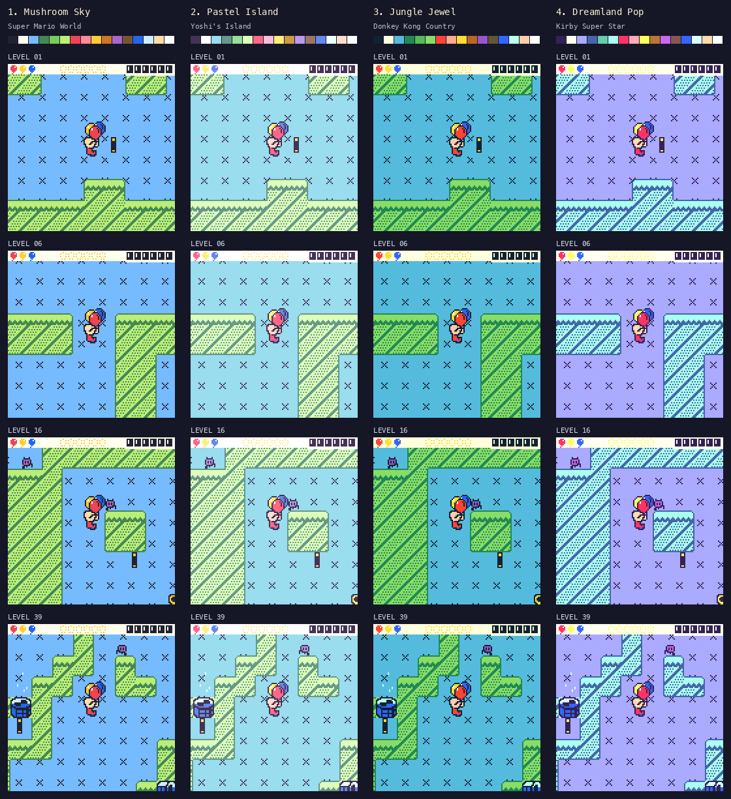
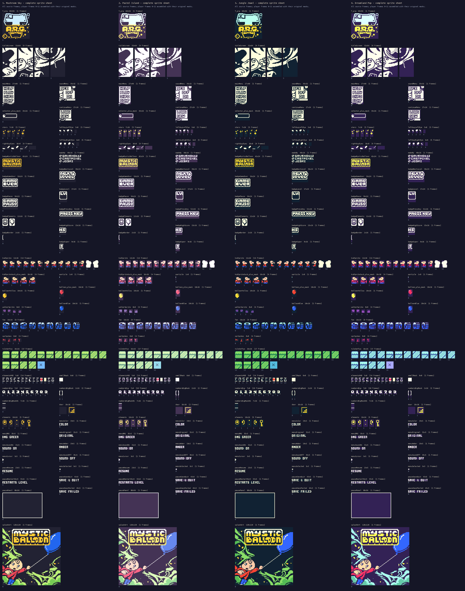

# Full-color palette studies

These are original color interpretations inspired by SNES-era games, rather
than reproductions of their palette data. All use a light peach face, dark
outlines and distinct red, yellow and blue balloons. The separate Original
B&W, DMG and Amber settings remain available in CONF.

| Option | Direction | Inspiration | Complete sprite sheet |
|---|---|---|---|
| 1 | Mushroom Sky | Super Mario World: blue sky, green terrain, primary colors | [Full sheet](sprites-mushroom.png) |
| 2 | Pastel Island | Yoshi's Island: softer cyan, mint and warm pastels | [Full sheet](sprites-pastel.png) |
| 3 | Jungle Jewel | Donkey Kong Country: deeper greens and jewel colors | [Full sheet](sprites-jungle.png) |
| 4 | Dreamland Pop | Kirby Super Star: lilac sky, cool terrain and pink accents | [Full sheet](sprites-dreamland.png) |



The same valid open-space positions are shown in each palette, with three
balloons displayed for contrast review. They are rendered by the actual
game code. These captures are composed for art review, rather than recorded
playthroughs.

The sheets include every original visual array and animation frame, the
three balloon colors, menu/pause lettering, and the continuous splash: 145
frames in 52 groups, at three screen pixels per source pixel. Player frames
0–11 are composed with the original silhouette; frames 12–13 show the
silhouette masks. The original graphics and level arrays are unchanged.
The splash was redrawn as one continuous scene in 1.2.2; see the
[drawing sources](../tools/art/splash/README.md) and
[actual menu review in all four display modes](splash-review.png).



Rebuild from the workspace root:

```sh
.venv/bin/python MysticBalloon/tools/art/build_art.py
.venv/bin/python MysticBalloon/tools/preview_color.py
```

`tools/art/build_art.py` defines the four 16-color candidates and builds the
compressed splash, menu labels and sprite tint masks. `color_preview.cpp`
exports native palette indices through the real renderer under UBSan;
`preview_color.py` applies the same palette tables and lays out the previews.
Color indices are shared across the four candidates, so palette comparison
does not alter sprite geometry or level content. Diagnostic command `T 0`
through `T 3` previews the candidates on the handheld. The release uses
candidate 2, Pastel Island, by default in release 1.2.1; the additional
candidates remain review alternatives. `CHMB_COLOR_VARIANT` in `config.h`
selects the default for the game, generated art previews and cartridge.
After changing it, rerun `build_art.py`, then rebuild the game and regenerate
the GIF and cartridge art so all outputs use the selected table.
