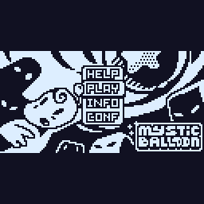
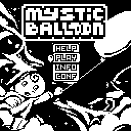
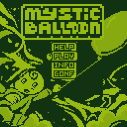
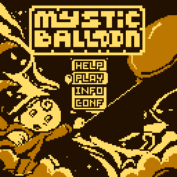

# Mystic Balloon for CHGame

I asked my daughter what Arduboy game she would want to play on the CHGame
Rev0, and she said Mystic Balloon! So here is a **128×128, 60 fps color
port** of TEAM a.r.g.'s **Mystic Balloon**.

Explore all 39 original levels with the original physics, bright
red/yellow/blue balloons and a continuous splash illustration.

**[Download version 1.4.0](https://github.com/juliendorra/mystic-balloon-chgame/releases/tag/v1.4.0)**:
[.chgame package (recommended)](https://github.com/juliendorra/mystic-balloon-chgame/releases/download/v1.4.0/MysticBalloon-1.4.0.chgame)
or [.bin firmware](https://github.com/juliendorra/mystic-balloon-chgame/releases/download/v1.4.0/MysticBalloon-1.4.0-rev0.bin).
The release includes USB and SD-card installation instructions and
[SHA-256 checksums](https://github.com/juliendorra/mystic-balloon-chgame/releases/download/v1.4.0/SHA256SUMS.txt).
No compiling needed.

Version **1.4.0** adds independent saved runs and mid-level resume. **PLAY**
shows **NEW**, an empty line, then your runs labelled by **level and percentage**.
The last played run is selected automatically; use Up/Down and **B to load**.
NEW keeps existing progress. HELP now explains controls, loading and saving. With an SD card, eight runs live in
`MYBLSAVE.DAT`, isolated from other games. Without SD, four runs use the
shared flash fallback. Pause, then **SAVE & QUIT**, to resume at the same
position with your coins, key, balloons and enemy state restored.
[Save-system behavior and checks](MysticBalloon/docs/save-system.md).

Version **1.3.0** plays the ATMlib title tune, five gameplay tunes and
tracker effects by default. In **CONF**, Left/Right changes **AUDIO ATM/BEEP**
and **SOUND ON/OFF** immediately. Sound rows preview the selected audio
and show its current state, using the confirmed color scheme. B saves;
A cancels all previews. SELECT mutes either mode. Existing checkpoints
and palettes are retained.
[Soundtrack implementation and checks](MysticBalloon/docs/atmlib-soundtrack.md).

| Color — Pastel Island (default) | Original B&W |
|:---:|:---:|
|  |  |

| Game Boy DMG | Amber |
|:---:|:---:|
|  |  |

The same title screen and gameplay sequence are shown in all four modes.

The default **Pastel Island** color palette is inspired by Yoshi's Island.
CONF also offers **Original B&W**, **Game Boy DMG** and **Amber**, with live
previews. START pauses; **SAVE & QUIT** returns to the main menu and keeps
your current run. [Controls and game rules](MysticBalloon/README.md).

## Install 1.4.0 and prepare SD saves

Download the [.chgame package](https://github.com/juliendorra/mystic-balloon-chgame/releases/download/v1.4.0/MysticBalloon-1.4.0.chgame)
and install it using the CHGame cart tools. The [.bin firmware](https://github.com/juliendorra/mystic-balloon-chgame/releases/download/v1.4.0/MysticBalloon-1.4.0-rev0.bin)
is available for direct USB flashing to CHGame Rev0. Both contain the same
normal release firmware, with both flash save pages preserved.

For SD saves, open the console's SD card reader and prepare the card once
with the standalone [prepare_saves.py helper](https://github.com/juliendorra/mystic-balloon-chgame/releases/download/v1.4.0/prepare_saves.py)
(Python 3; no extra dependencies):

```sh
python3 prepare_saves.py --card "/path/to/mounted/card"
```

Replace the path with your actual SD mount, such as `/Volumes/NO NAME` on
macOS. The helper creates a missing `MYBLSAVE.DAT`, preserves valid existing
runs, and refuses to replace damaged saves. Safely eject the card before
starting the game. An existing valid legacy flash checkpoint imports into
the first run; its old format only retained the level entrance.
Back up `MYBLSAVE.DAT` to keep all your runs.

From a source checkout, the launcher also prepares saves automatically:

```sh
python3.12 mysticballoon.py cart deploy MysticBalloon-1.4.0.chgame --card "/path/to/mounted/card"
```

## Build and upload

Install Python 3.12+, Git and [Arduino CLI](https://arduino.github.io/arduino-cli/).
The simulator also needs a C++ compiler: Clang or GCC.

```sh
git clone https://github.com/juliendorra/mystic-balloon-chgame.git
cd mystic-balloon-chgame
python3.12 mysticballoon.py setup
python3.12 mysticballoon.py check
python3.12 mysticballoon.py upload
```

Setup downloads the external [CHGame SDK](https://github.com/bateske/CHGame)
at commit `e1f8d05940ddb7bbef89c13326da75c003f02904` and installs board
package **0.3.0** plus the pinned Python dependencies. The SDK and downloaded
tools are ignored by Git. This repository contains only Mystic Balloon.
On Apple Silicon, the board package's bundled compiler may require Rosetta.

For simulator checks without installing the Arduino board package:

```sh
python3.12 mysticballoon.py setup --host-only
python3.12 mysticballoon.py check --no-device
```

In Arduino IDE, install the CHGame board package following its
[installation guide](https://github.com/bateske/CHGame#-get-started), open
`MysticBalloon/MysticBalloon.ino`, and select **CHGame Rev0**, **Smallest + LTO**,
and **Upload only**.

## Package and inspect

```sh
python3.12 mysticballoon.py export
python3.12 mysticballoon.py cart verify MysticBalloon/build/MysticBalloon.chgame
python3.12 mysticballoon.py gif
```

The cartridge is `MysticBalloon/build/MysticBalloon.chgame`; the firmware
is `MysticBalloon/build/release/MysticBalloon.ino.bin`. Build products stay
local. The [art sources](MysticBalloon/tools/art/splash/README.md),
[pixel drawing workflow](MysticBalloon/docs/pixel-art-workflow.md), and
[Arduboy porting guide](docs/arduboy-porting.md) explain the port's methods.

## Validation

Version 1.4.0 passed the deterministic host suite with undefined-behavior
checks, including independent NEW runs, loading through the actual menu,
last-played selection, HELP content in all four palettes, exact mid-level
round trips, legacy migration,
foreign-game flash protection, full-slot refusal and all **512 interrupted
SD-sector write positions**. The sprite/level data and all 39 maps remain
unchanged. The production splash is losslessly compressed to make room
for saves, with all four modes checked against the source pixels.

On physical CHGame Rev0, SD storage, NEW, a real coin collision, pause,
SAVE & QUIT, mid-level loading and preservation of an older run passed.
A one-second resumed gameplay window rendered 61 frames with zero late
frames and a 1,600-byte stack watermark. The final menu loaded the original
level-16 checkpoint with its score and campaign coins intact. The normal
firmware and SD cartridge were installed and checked, preserving all 41
other card files. [Installation record](MysticBalloon/docs/install-saves-1.4.0.json).

Exact 1.4.0 firmware: **49,644 bytes**, CRC32 **`0x2A72DF24`**. Static RAM is
**18,112 bytes**, with a separate **2,048-byte** stack and both flash save
pages retained. The bootloader verified the programmed CRC; its version
does not support independent byte readback. These are the same bytes in
the release package and firmware download.

The existing audio checks retain **15,303 matching ATM tracker states**,
six non-clipping PCM renders, **452 matching classic sound events** and
**180 timer cases**. The viewport survey covers **17,199 positions**,
plus 1,716 platform references and 320 player composites. The 1.3.0 physical
45-scenario gameplay/audio benchmark is historical; see its
[device results](MysticBalloon/docs/device-audio-1.3.0.json) and
[CONF checks](MysticBalloon/docs/device-audio-modes-1.3.0.json).
SD-controller power-loss behavior and overnight electrical retention are
not measured by the software failure-injection tests.

## License and credits

Game and scores: [MIT](LICENSE). ATMlib: [BSD 3-Clause](MysticBalloon/ATMLIB-LICENSE).
The private CHSd-derived save driver is [MIT licensed](MysticBalloon/SAVE-CARD-LICENSE).
Original Mystic Balloon (Arduboy 1.7.2), copyright © 2016
TEAM a.r.g.; credits to GAVENO, CastPixel, JO3RI and Martian220, with thanks
to MLXXXP for the Arduboy2 migration. The original sprite and level arrays
match [upstream commit 58743b6](https://github.com/Team-ARG-Museum/ID-34-Mystic-Balloon/tree/58743b6b52f1aa9f7bc39efd807034a83ebed9a6).
See [NOTICE](NOTICE) for the adaptation and asset provenance.
