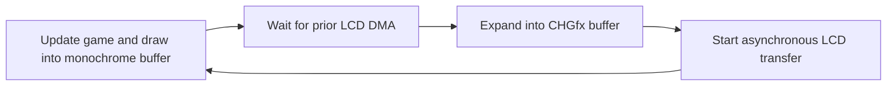

# Porting Arduboy games to CHGame at 60 fps

Keep the original game rules and timing, preserve packed graphics, and
measure the complete frame on the handheld before calling a port fast.
Mystic Balloon's first implementation passed simulator correctness checks
but ran at about 26–31 fps on CHGame Rev0. Reworking its drawing and display
pipeline brought it to approximately 60 fps without changing its physics
or artwork.

This guide uses the workspace's CHGame 0.3.0 board package and native GCC
16.2.0 toolchain. The [Mystic Balloon measurements](../MysticBalloon/docs/performance.md)
contain the recorded timings, device results, and release identity.

Mystic Balloon 1.1.0 expands gameplay to 128×128 and removes the added UI.
The timing comparison below records the earlier 1.0.1 128×64 optimization;
the same packed renderer now handles twice as many rows. Current viewport
and device results are recorded separately in the measurements.

## The 128×64 optimization

For level 1 with Right held, the device recorded these average costs:

| Stage | First implementation | Optimized implementation |
|---|---:|---:|
| Game pass, including original sprite drawing | 28.300 ms | 2.586 ms |
| Expand monochrome pixels into CHGfx pixels | 3.123 ms | 0.666 ms |
| Draw title and control labels | 3.720 ms | 0.004 ms when unchanged |
| Total CPU work, including wait and submission | 35.260 ms | 3.369 ms |

The combined change reduced CPU work by about 10.5 times in this scenario.
The game remains capped at 60 fps. These are measurements of the combined
pipeline changes; they do not isolate the gain from SRAM placement alone.

The initial renderer read a sprite bit, calculated a destination pixel,
and modified that pixel for every sprite pixel. An Arduboy source byte
already represents eight vertical pixels. The optimized renderer operates
on that byte directly, using a copy for aligned opaque sprites and shifted
masks for other positions. It also executes the two hot drawing loops from
SRAM, converts the display buffer in packed groups, keeps unchanged labels,
and transfers only the changing part of the LCD.

The first implementation retransmitted the entire 128×128 display.
Version 1.0.1 sent 128×64 pixels during normal play, halving the pixel
payload while retaining static title and controls on the LCD. Version
1.1.0 uses the entire screen for the world and sends all 128×128 pixels.

## Start with the source and a frame budget

Record the upstream URL, exact commit, license, credits, level order, frame
rate, controls, save layout, and bitmap formats. Preserve the license and
attribution with the port. Asset fingerprints make later optimization
independent of accidental artwork or level changes; Mystic Balloon's
[asset manifest](../MysticBalloon/tools/upstream-assets.json) covers 81 arrays.

At 60 fps the time between frame starts is 16.667 ms. Measure game logic,
sprite drawing, format conversion, labels, waiting for DMA, and transfer
submission separately. Track actual frame intervals and late frames too.
A CPU timer ending at an asynchronous flush does not include the remaining
wire transfer.

The [simulator](../CHGame/tools/chsim/chsim.py) is useful for deterministic
input, pixels, state transitions, and DMA hazards. Its virtual clock and
host processor do not reproduce the target CPU's instruction costs.
A GIF running at 60 fps therefore establishes the intended timing, not
the achievable device frame rate.

## Choose the framebuffer representation

| Source game | Starting approach | Reason |
|---|---|---|
| Arduboy page-packed monochrome sprites | Keep a 1 KiB 128×64 buffer, then expand it once per frame | Preserves sprite formats and masking while keeping drawing cheap |
| Existing CHGame or colour assets | Draw packed 4 bpp pixels or native span sprites | Avoids an unnecessary monochrome conversion |
| A game needing more visible world | Change the viewport as a separate gameplay decision | Revealing more world can change difficulty and camera behaviour |

Mystic Balloon initially used the first approach, centered at Y=32.
Version 1.1.0 uses a 2 KiB 128×128 monochrome buffer, with square pixels and
more visible world. CHGfx retains its 8 KiB 128×128 framebuffer. The separate
monochrome buffer lets the game draw its next scene while the previous LCD
transfer reads the native framebuffer.

[Port.h](../MysticBalloon/Port.h) is an adapter for the Arduboy operations
this game uses. Review the next game's API calls before reusing it. It is
a local implementation, with game-specific saving and names, rather than
a complete Arduboy library replacement.

## Expand a scrolling viewport

Changing the buffer height is only the first step. Derive these quantities
from the new viewport dimensions:

- Buffer bytes and sprite clipping: `width * height / 8` for page-packed data.
- Camera anchor: Mystic Balloon centers the 12×16 player at `(58, 56)`.
- Camera limits: `level width - view width` and `level height - view height`;
  both are 256 for its 384×384 worlds and 128×128 view.
- Visible tile rows and columns, including one extra tile for partial edges.
  Parallax backgrounds need the same coverage check.
- Off-screen fall/death thresholds and camera initialization at level spawn.
- Expansion height and LCD transfer rectangle. An animated full-screen world
  needs a full-screen transfer even if the previous version used a band.

Keep menu artwork at its own dimensions. Mystic Balloon centers its original
64-row menus and expands the world and original HUD to 128 rows. Capture the
state used to draw a frame before dispatching its handler: a handler may
change state while the pixels still belong to the preceding screen. Choose
the expansion layout using that captured state.

Test all camera corners, unaligned scrolling, doors, parallax and the lowest
world rows against an independent pixel reference. Recheck masks at the new
bottom edge and measure the larger workload on hardware. More visible world
changes the player's information even when physics and level data stay fixed.

## Draw eight pixels with each source byte

For a source sprite column byte, split the destination Y into a page and
a bit offset:

```cpp
int page = y >> 3;
unsigned shift = y & 7;
uint16_t image = uint16_t(sourceImage) << shift;
uint16_t mask = uint16_t(sourceMask) << shift;

// After clipping, the low byte belongs to page and the high byte to page+1.
dstLow  = (dstLow  & ~uint8_t(mask))      | uint8_t(image);
dstHigh = (dstHigh & ~uint8_t(mask >> 8)) | uint8_t(image >> 8);
```

This is the mask operation, not a complete clipping implementation. Select
the mask and image according to the source operation:

| Operation | Effective mask | Effective image |
|---|---|---|
| Overwrite | All valid source pixels | Source image |
| Self masked | Source image bits | Source image |
| Erase | Source image bits | Zero |
| Plus mask | Explicit source opacity mask | Source image |

When the sprite is page-aligned, opaque overwrite becomes a byte copy.
An unaligned byte affects at most two destination pages. Plus-mask sprites
in this game store each image byte immediately followed by its mask byte;
include both bytes when computing frame offsets.

Clip before forming framebuffer pointers. Mask unused bits in the final
source page when the height is not a multiple of eight. Test negative
positions, the bottom edge, every Y offset from zero through seven, and
successive animation frames. A bounds check around a store does not make
an already out-of-bounds pointer valid.

The implementation is [PortSprites::draw](../MysticBalloon/Port.cpp).
The source data stays packed and unchanged; no expanded sprite cache is
needed.

## Execute small hot loops from SRAM

This CH32X035 configuration has flash wait states and no instruction
cache. Use the library's [RAMFUNC macro](../CHGame/platform/board/arduino/CHGame/libraries/CHGame/src/chgame/RamFunc.h)
on measured hot loops:

```cpp
RAMFUNC(myGameSpriteRow) void drawSpriteRow(/* arguments */) {
    // Packed drawing loop.
}
```

Give each function a unique section name. The linker stores its initial
bytes in the firmware image and copies them into SRAM at startup. Check
both memory totals after moving code: execution becomes cheaper at the
cost of SRAM capacity.

In Mystic Balloon 1.0.1's release map, `mysticSprites` occupies 502 bytes
and `mysticExpand` occupies 220 bytes in SRAM. Menus, save code, and general
game logic stay in their normal sections. Pinball uses the same technique
for its beam and zoom loops in [Render.cpp](../Pinball/Render.cpp), and Ball
uses it for its packed sprite loop in [Ball.ino](../Ball/Ball.ino).

## Expand pixels in groups and cache static drawing

CHGfx stores two horizontal pixels per byte. For monochrome colours 0 and
1, expanding one pair of columns at source bit position `row` is:

```cpp
packed = ((leftColumn >> row) & 1)
       | (((rightColumn >> row) & 1) << 4);
```

Load the two column bytes once, then write their eight output rows. The
fixed-size loop can use eight direct stores, avoiding repeated source
loads and loop bookkeeping. See `PortDisplay::render` in
[Port.cpp](../MysticBalloon/Port.cpp). A different colour mapping needs
different nibble values; the operation above assumes palette indices 0/1.

If a port has static title or control bands, draw them once and cache each
band by every value that can change its pixels. Version 1.0.1 used play/menu
mode, level, key ownership and menu sound state. Invalidate cached drawing
after a framebuffer clear or another operation that overwrites it.
Version 1.1.0 removes those bands and draws the original pause badge directly
into the monochrome world buffer.

This differs from skipping a whole frame. The world, HUD, enemies and
player still update and render on each game tick. Only unchanged labels
and their LCD payload are retained.

## Schedule framebuffer access around DMA

The frame loop has four stages:



Work in the monochrome buffer can overlap DMA because it is separate
memory. Wait before modifying any native framebuffer bytes still being
read by DMA. The straightforward sequence is:

```cpp
updateAndDrawMonochrome();
gfx_wait();
commitPendingSaveIfNeeded();
expandIntoNativeFramebuffer();
gfx_flushAsync(); // The 128×128 world changes across the full screen.
```

Those helper names describe the sequence; adapt them to the game. If the
game uses a smaller changing band, track changes outside that band before
choosing a partial transfer.
`gfx_flushRectAsync` sends an area of the existing framebuffer. Coordinates
are clipped and rounded to the alignment documented by
[CHGfx](../CHGame/platform/board/arduino/CHGame/libraries/CHGfx/src/CHGfx.h).
The rectangle must cover every changed pixel, including overlays and
status transitions.

Pinball's [present function](../Pinball/Pinball.ino) follows the same
principle with different boundaries: it checks its top and bottom bands
and omits unchanged ones from transfers. Reuse that principle while
choosing boundaries that match the new game's layout.

## Audit AVR and SDK assumptions

| Assumption to inspect | CHGame porting action |
|---|---|
| AVR `int`, `unsigned long`, `char`, and `byte` sizes | Use explicit integer widths where storage or overflow matters; use `uint8_t` for byte counters and packed flags |
| A function pointer loaded with `pgm_read_word` | Read it as a native-width pointer; a 16-bit word cannot hold it on RISC-V or a 64-bit host |
| Left shifts of signed negative values | Use defined arithmetic such as multiplication for fixed-point scaling |
| Speed macros used with unary minus | Parenthesize the complete expression |
| Packed bitmap or record alignment | Verify offsets and alignment before word accesses; retain byte access where alignment is unknown |
| `%lu` or other `%l` formatting | This board package's nano printf lacks `%l`; use CHGame's `fmtInt` and `fmtStr` for suitable integer ranges |
| EEPROM writes inside a frame loop | Stage a checkpoint and commit through `save::` only when its data changes |
| Save records shared with another game | Choose a unique magic, validate fields, define the record layout, and version format changes |

Keep signedness explicit in loops that count down through zero. On one
platform `unsigned long` may be 32 bits and on another 64 bits. Match
diagnostic format specifiers to the actual argument type, and verify the
formatter on hardware as well as on the host.

CHGame saves use two flash pages and the graphics scratch buffer. Load the
record once before storing, then commit between `gfx_wait()` and the next
flush. Finish score/bonus tallies before recording a level checkpoint.
Compare defined fields or a deliberately initialized layout when deciding
whether a record changed; padding bytes can invalidate a raw comparison.

## Validate pixels and real frame timing

Preserve a deterministic gameplay capture before editing the renderer.
Afterward, compare its pixels to the optimized version. Test masks with an
independent simple pixel implementation, including cases not seen in a
normal playthrough. Mystic Balloon's [port tests](../MysticBalloon/tools/tests/port_test.cpp)
cover 6,840 sprite cases, all output pixels of both expansion layouts,
18 camera placements, game flow, and all 39 level loaders under UBSan.

On the handheld, collect game/sprite time, DMA wait, expansion, labels,
submission, total CPU work, frame intervals, late frames, and stack use.
The library's `P` result measures the section enclosed by
`dbg::markRenderStart/End`. In this port that section omits the much more
expensive original sprite pass. Its `U` command in
[Perf.h](../MysticBalloon/Perf.h) adds the full stage measurements.

In its `U` report, `game` includes original sprite drawing; `wait` includes
waiting for the previous DMA and any pending checkpoint save; `expand` and
`chrome` cover the native buffer and labels (zero chrome in 1.1.0); `submit` ends when the new
asynchronous transfer has started. `work` includes all those stages, while
`interval` measures time between frame starts. Reset sums and peaks at the
start of each measurement window so they cover the same workload and stay
within the counters' range.

Use free-running mode for timing. Lockstep `N` commands establish behaviour
and pixel identity but advance frames on demand. After switching from
lockstep to free-running mode, let the clock settle before resetting
counters. Measure sustained scenes for several seconds, keep sound
enabled when the game uses it, and include busy scenes, scrolling,
inhalation/effects, menu transitions, and saving where relevant.

The [device checker](../MysticBalloon/tools/verify_device.py) measures the
native stages alongside wall-clock frame counts, records JSON, and checks
input and pause. Its 57 fps threshold allows serial-measurement tolerance;
the evidence for smooth 60 fps also includes late frames and worst frame
work. Distinguish a short visit to every level from a complete playthrough.
The historical 128×64 validation visited all 39 levels and exercised three
longer scenarios; its worst observed CPU-work time was 5.185 ms with zero
late frames across 42 scenarios. Consult the measurement page for the
separate 128×128 results.

## Build and deliver a measured port

Run the cheap checks first, then batch related fixes before device work.
Before taking the USB device, announce the diagnostic run and check for
another process using it. Use the supported uploader/probe and release the
port after scripts. Return the handheld to a normal release afterward.

The following are working commands for Mystic Balloon, run from this
workspace's root. For another port, adapt its launcher, paths, debug
identity, save magic, and game-specific scripts. The launcher carries the
workspace's compiler and board-package environment.

```sh
# Software correctness, deterministic captures, and target size.
python3 mysticballoon.py check

# Capture a baseline and compare after an optimization.
python3 mysticballoon.py run tools/scripts/gameplay.txt out/before
# Make the rendering change here, then capture the same input sequence.
python3 mysticballoon.py run tools/scripts/gameplay.txt out/after
python3 mysticballoon.py check --compare MysticBalloon/out/before MysticBalloon/out/after

# Build, install and measure diagnostics when the device is available.
python3 mysticballoon.py build --debug
python3 mysticballoon.py uploader probe
python3 mysticballoon.py uploader flash MysticBalloon/build/debug/MysticBalloon.ino.bin --device rev0 --run --quiet
.venv/bin/python MysticBalloon/tools/verify_device.py --port /dev/cu.usbmodem101

# Restore the normal release, then package that exact image.
python3 mysticballoon.py upload
python3 mysticballoon.py export --no-build
python3 mysticballoon.py cart verify MysticBalloon/build/MysticBalloon.chgame
```

Capture `out/before` before making the optimization. Get the USB port from
the probe; the example port name is not fixed. `check` performs local
target compilation and does not upload to a device. The measured debug
build should retain the release's gameplay and sound; document any
features omitted to fit diagnostic code.

CHGame Rev0's current limits are 50,944 firmware bytes and 18,416 bytes
for static RAM plus heap, with a separate 2,048-byte stack reservation.
Keeping both save pages requires an image no larger than 50,432 bytes.
Use the build's size check and map file to establish the actual totals.
Mystic Balloon 1.0.1 used 29,832 firmware bytes and 14,064 static RAM bytes;
the current build totals are recorded in its release notes.

Keep the upstream commit/license, software checks, hardware scenarios and
timings, build sizes, exact release CRC/hash, and accepted upload result
with the port. A bootloader accepting the image establishes the flash
transfer; frame-rate and input checks establish game behaviour on the
device. Preserve both kinds of evidence, as in Mystic Balloon's
[release notes](../MysticBalloon/NOTES.md) and
[hardware results](../MysticBalloon/docs/performance.md).
